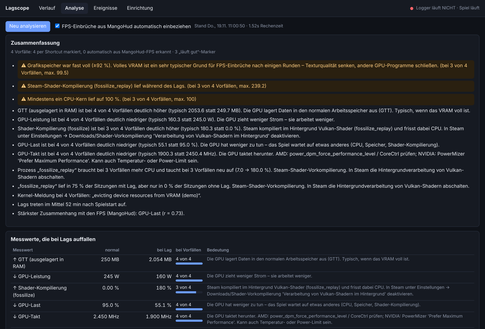
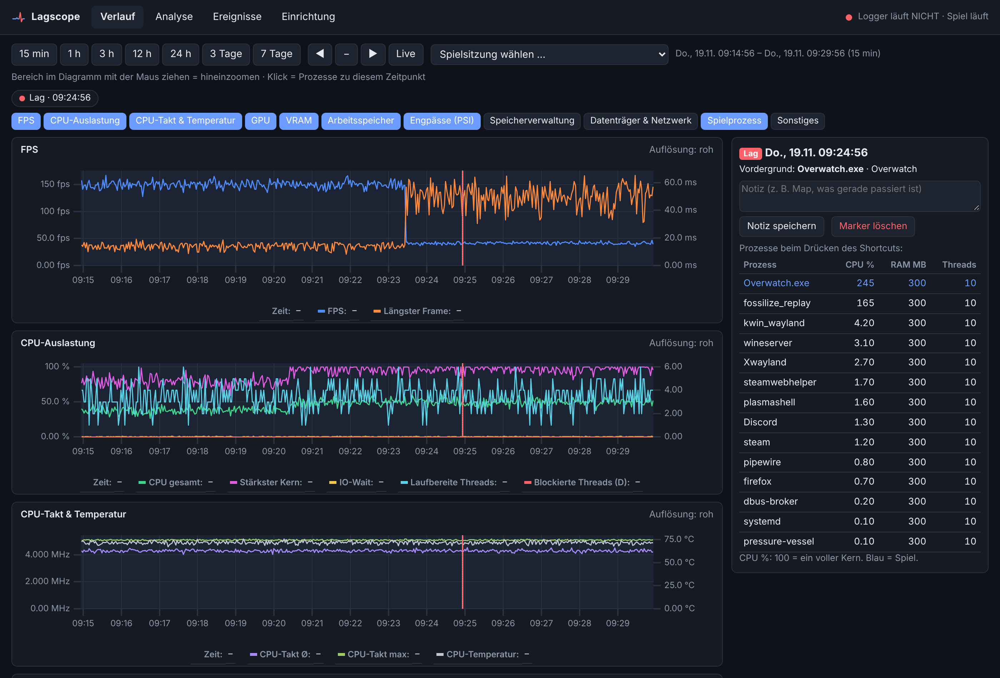

# Lagscope

Findet heraus, **warum ein Spiel plötzlich ruckelt** – z. B. wenn Overwatch statt 100–160 FPS auf einmal nur
noch 20–60 FPS schafft und nur ein Neustart hilft. Läuft unter **Linux und Windows**.

Lagscope läuft unauffällig im Hintergrund und schreibt alle paar Sekunden mit, was der PC gerade macht
(CPU, GPU, VRAM, RAM, Temperaturen, Takt, Engpässe, Festplatte, Netzwerk, Prozesse, Fenster im Vordergrund,
Kernel-/Systemmeldungen …). Sobald es ruckelt, drückst du ein **Tastenkürzel** – das setzt einen Marker.
Die **Auswertung im Browser** zeigt dann, was die Lag-Momente gemeinsam haben – über mehrere Tage hinweg,
automatisch.





- **Portabel:** irgendwohin kopieren, doppelklicken. Keine Installation, keine Zusatzpakete.
- **Sparsam:** ca. 0,1–0,5 % eines CPU-Kerns und ~30 MB RAM, mit niedriger CPU- und IO-Priorität. Der eigene
  Verbrauch wird mitgemessen und angezeigt.
- **Flüssige Auswertung:** der Browser bekommt nie Rohdaten, sondern immer nur ≤ 1500 vorberechnete Punkte pro
  Linie für den sichtbaren Zeitraum – auch bei Wochen an Daten.
- **Nur lokal:** die Weboberfläche ist nur auf diesem PC erreichbar (127.0.0.1), es wird nichts verschickt.
- **Zeichnet immer alles auf.** Man muss keine Programme auswählen – die Ursache ist meist *nicht* das Spiel
  selbst. Der Spielname dient nur dazu, Spielsitzungen zu erkennen.

## Download

**[→ Neueste Version herunterladen](https://github.com/HerbertHorst/LagLogger/releases/latest)**

| System | Datei | Inhalt |
|---|---|---|
| Windows 10/11 | `lagscope-windows.zip` | `lagscope.exe` (kein Python nötig) + `PresentMon.exe` für FPS |
| Linux | `lagscope-linux.zip` | `lagscope` (eine Datei, braucht Python 3.8+, ist überall vorinstalliert) + `Lagscope.desktop` |

Die Downloads werden bei jeder Änderung automatisch gebaut und auf echtem Windows bzw. Linux getestet.

## So läuft es im Alltag

|  | Windows | Linux |
|---|---|---|
| Starten | Doppelklick auf `lagscope.exe` | Doppelklick auf `Lagscope.desktop` (oder `python3 lagscope`) |
| Sieht man, dass es läuft? | **Symbol im Infobereich der Taskleiste** (rechts unten, ggf. im ^-Menü). Rechtsklick: Auswertung öffnen · Lag markieren · Beenden | Kein Symbol – Status steht oben rechts in der Auswertung; Menüeintrag „Lagscope“ öffnet sie |
| Autostart | Einrichtung → „Autostart aktivieren“ | Einrichtung → „Autostart aktivieren“ |
| Lag markieren | **`Strg+Alt+L`** – eingebaut, funktioniert im Vollbild, piept zur Bestätigung | eigenes Tastenkürzel in KDE/GNOME (siehe unten), Bestätigung als Benachrichtigung |
| „Läuft gut“ / „Lag vorbei“ (optional, mit FPS-Daten unnötig) | `Strg+Alt+G` / `Strg+Alt+K` | eigene Tastenkürzel (optional) |
| FPS | **automatisch** mit PresentMon (liegt bei) – einmalig Berechtigung erteilen | MangoHud – einmalig eine Startoption in Steam |
| Temperaturen | optional mit LibreHardwareMonitor | automatisch |
| Auswertung | Tray-Symbol → „Auswertung öffnen“ oder Doppelklick auf die EXE | Doppelklick oder Menüeintrag „Lagscope“ |

Die Auswertung läuft im normalen Browser. Der Logger läuft weiter, auch wenn der Browser zu ist.

## Einrichtung unter Windows

1. `lagscope-windows.zip` entpacken und den Ordner irgendwohin legen, z. B. `C:\Tools\Lagscope`.
2. **Doppelklick auf `lagscope.exe`.** Weil das Programm nicht signiert ist, zeigt Windows eventuell
   „Der Computer wurde durch Windows geschützt“ → *Weitere Informationen* → *Trotzdem ausführen*.
3. Im Browser öffnet sich die Auswertung, unten rechts erscheint das Lagscope-Symbol. Im Tab **Einrichtung**:
   - **Autostart aktivieren.**
   - **„Berechtigung für FPS-Messung einrichten“** klicken (öffnet ein Admin-Fenster, fügt dich der
     Windows-Gruppe „Leistungsprotokollbenutzer“ hinzu), danach einmal ab- und wieder anmelden. Ab dann misst
     Lagscope die FPS automatisch, sobald das Spiel läuft – siehe auch
     [FPS messen – Overwatch über Battle.net oder Steam](#fps-messen--overwatch-über-battlenet-oder-steam).
   - optional **Temperaturen:** [LibreHardwareMonitor](https://github.com/LibreHardwareMonitor/LibreHardwareMonitor/releases)
     als Administrator starten und *Options → Remote Web Server → Run* einschalten. Ohne LibreHardwareMonitor
     fehlen nur Temperaturen und genaue Taktraten – GPU-Last, VRAM, CPU-Last und -Takt liest Lagscope direkt aus
     Windows (bei NVIDIA zusätzlich Temperatur und Takt über den Treiber).
4. Spielen. Wenn es ruckelt: **`Strg+Alt+L`**.

## Einrichtung unter Linux

1. `lagscope-linux.zip` entpacken und den Ordner irgendwohin legen, z. B. `~/Programme/lagscope`.
2. **Doppelklick auf `Lagscope.desktop`** (beim ersten Mal ggf. „Vertrauen“ / „Ausführen erlauben“).
   Alternativ im Terminal: `python3 lagscope`.
3. Im Tab **Einrichtung**:
   - **Autostart aktivieren.**
   - **Menüeinträge anlegen** und ein **Tastenkürzel** auf „Lagscope: Lag markieren“ legen.
     *KDE Plasma* (Bazzite, CachyOS, Kubuntu, SteamOS-Desktop …): Systemeinstellungen → Tastatur → Kurzbefehle →
     Neu → Anwendung. *GNOME*: Einstellungen → Tastatur → Eigene Tastenkombinationen, Befehl aus der Einrichtung
     kopieren.
   - optional, aber empfohlen: **MangoHud für FPS** – siehe
     [FPS messen – Overwatch über Battle.net oder Steam](#fps-messen--overwatch-über-battlenet-oder-steam).
4. Spielen. Wenn es ruckelt: Tastenkürzel drücken.

**Prüfen, ob alles ankommt:** `python3 lagscope selftest` (Windows: `lagscope.exe selftest` in der
Eingabeaufforderung) zeigt in wenigen Sekunden, welche Messwerte auf diesem PC verfügbar sind und warum
andere fehlen.

## FPS messen – Overwatch über Battle.net oder Steam

Mit FPS-Daten reicht beim Spielen die eine Lag-Taste: Lagscope erkennt dann selbst, wann der Lag angefangen hat,
wann er vorbei war und was „normal“ ist (siehe [Was die Marker bedeuten](#was-die-marker-bedeuten)).

> **Das Feld „Zusätzliche Befehlszeilenargumente“ in der Battle.net-App bleibt leer – unter Windows und Linux.**
> Was dort steht, bekommt nur `Overwatch.exe` als Startparameter. Die FPS-Messung lässt sich darüber nicht
> einschalten; fremde Einträge dort können den Spielstart sogar verhindern.

### Windows: PresentMon (liegt bei, keine Installation)

MangoHud gibt es unter Windows nicht – und es wird nicht gebraucht. Lagscope startet **PresentMon** (liegt im
Download neben `lagscope.exe`) automatisch, sobald Overwatch läuft, egal ob über Battle.net oder Steam.

Einmalig:
1. Lagscope starten → im Browser Tab **Einrichtung** → **„Berechtigung für FPS-Messung einrichten (Admin)“** →
   im Admin-Fenster bestätigen.
2. Einmal **ab- und wieder anmelden** (oder neu starten).

Prüfen: Nach einer Runde steht in der Einrichtung bei PresentMon „läuft“ bzw. „bereit“ und die Zahl
„Sekunden FPS-Daten“ steigt; im Verlauf erscheint das FPS-Diagramm. Steht dort „keine Rechte“, fehlt noch das
Ab- und Anmelden. Fehlt `PresentMon.exe` (z. B. vom Virenscanner entfernt), einfach aus dem Download wieder neben
`lagscope.exe` legen.

### Linux: MangoHud

#### 1. MangoHud installieren

**Bazzite:** nichts zu tun – MangoHud ist vorinstalliert. Prüfen mit `mangohud --version`.

| Distribution | Befehl im Terminal |
|---|---|
| Fedora, Nobara | `sudo dnf install mangohud` |
| Ubuntu, Linux Mint, Pop!_OS, Debian | `sudo apt install mangohud` |
| Arch, CachyOS, Manjaro, EndeavourOS | `sudo pacman -S mangohud lib32-mangohud` |
| openSUSE Tumbleweed | `sudo zypper install mangohud` |
| Steam als **Flatpak** installiert (zusätzlich) | `flatpak install flathub org.freedesktop.Platform.VulkanLayer.MangoHud` |

Bei Flatpak-Steam muss Steam außerdem in den Lagscope-Ordner schreiben dürfen:
`flatpak override --user --filesystem=/pfad/zu/lagscope com.valvesoftware.Steam` (Pfad anpassen).
Auf Bazzite ist Steam normal installiert, dort ist das nicht nötig.

#### 2. Den Ordner für die Logs herausfinden

Die Logs gehören in den Ordner `lagscope-data/mangohud` **neben der `lagscope`-Datei**, z. B.
`/home/DEINNAME/Programme/lagscope/lagscope-data/mangohud`. Den Pfad komplett ausschreiben (kein `~`), er darf kein
Komma enthalten. Lagscope muss einmal gestartet worden sein – es legt den Ordner an.

**Am einfachsten:** Lagscope → Tab **Einrichtung** → Karte „3. FPS mitschreiben“ – dort stehen die Zeilen unten
schon mit dem richtigen Pfad zum Kopieren.

#### 3. MangoHud für Battle.net einschalten

Die Einstellung kommt **dorthin, von wo Battle.net gestartet wird** – nicht in Battle.net selbst und nicht an einen
eigenen Overwatch-Eintrag. Overwatch wird vom Launcher gestartet und übernimmt sie automatisch.

**Battle.net als Nicht-Steam-Spiel in Steam** (üblich auf Bazzite):
1. Steam → Bibliothek → Rechtsklick auf **Battle.net** → **Eigenschaften** → **Allgemein** → **Startoptionen**:
   ```
   MANGOHUD=1 MANGOHUD_CONFIG="autostart_log=1,output_folder=/home/DEINNAME/Programme/lagscope/lagscope-data/mangohud" %command%
   ```
   Stand dort schon etwas: `MANGOHUD=1 MANGOHUD_CONFIG="…"` davor setzen, `%command%` nur einmal ganz am Ende.
2. Battle.net **komplett beenden** – auch das Symbol im Infobereich (Rechtsklick → Beenden). Läuft noch eine alte
   Instanz, greift die Einstellung nicht.
3. Battle.net **über Steam** starten, dann Overwatch.

**Lutris:**
1. Rechtsklick auf **Battle.net** → **Konfigurieren** → Reiter **Systemoptionen**.
2. **„MangoHud aktivieren“** einschalten.
3. Unter **Umgebungsvariablen** hinzufügen – Schlüssel `MANGOHUD_CONFIG`, Wert (ohne Anführungszeichen):
   ```
   autostart_log=1,output_folder=/home/DEINNAME/Programme/lagscope/lagscope-data/mangohud
   ```
4. Speichern, Battle.net komplett beenden und neu starten.

**Heroic, Faugus, Bottles:** beim Battle.net-Eintrag bzw. in der Flasche MangoHud einschalten und dieselbe
Umgebungsvariable `MANGOHUD_CONFIG` wie bei Lutris anlegen.

**Overwatch direkt über Steam** (ohne Battle.net): dieselbe Zeile wie oben in die Startoptionen von Overwatch.

#### 4. Prüfen

- Im Spiel erscheint oben links das **MangoHud-Overlay** mit den FPS → MangoHud ist aktiv.
- Nach dem Spielen (je nach MangoHud-Version erst nach Spielende) liegt im Ordner eine Datei wie
  `Overwatch_2026-11-20_20-15-03.csv`. In der Einrichtung steht dann „Bisher importiert: 1 Datei(en)“, im Verlauf
  erscheint das FPS-Diagramm.
- Eine zusätzliche `Battle.net_….csv` ist normal (MangoHud läuft auch im Launcher) – Lagscope liest nur Logs ein,
  deren Name den Spielnamen enthält, und zeigt den Rest als „übersprungen“.

| Problem | Ursache / Lösung |
|---|---|
| Kein Overlay im Spiel | Battle.net lief noch im Hintergrund → komplett beenden, neu über Steam/Lutris starten. Bei Flatpak-Steam: MangoHud-Flatpak installiert? |
| Overlay da, aber keine `.csv` | Pfad falsch, enthält `~` oder ein Komma, oder der Ordner existiert nicht (Lagscope einmal starten) |
| `.csv` da, aber nicht importiert | Dateiname enthält nicht den Spielnamen → Spielname in Lagscope (Einrichtung → Logger) prüfen |

## Unterstützte Systeme

### Linux

Getestet mit dem vollständigen Rauchtest (Analyse, Logger, Weboberfläche, Marker, Selbsttest, MangoHud-Import)
in den offiziellen Container-Images der Distributionen – mit deren eigener Python-Version, als normaler Benutzer:

| Distribution | Python | Ergebnis |
|---|---|---|
| **Bazzite 45** (Fedora Kinoite, KDE) | 3.15 | ✅ inkl. Doppelklick-Starter, Autostart, Menüeinträgen, `xprop`/`xdotool` vorinstalliert |
| Fedora 42 / 43 / Rawhide | 3.13 / 3.14 / 3.15 | ✅ |
| Nobara, Ultramarine, andere Fedora-Abkömmlinge | wie Fedora | ✅ (gleiche Basis, nicht einzeln getestet) |
| Ubuntu 20.04 / 22.04 / 24.04 / 26.04 | 3.8 / 3.10 / 3.12 / 3.14 | ✅ |
| Linux Mint 22, Pop!_OS, Zorin, Kubuntu … | wie Ubuntu | ✅ (Mint getestet) |
| Debian 12 / 13 | 3.11 / 3.13 | ✅ |
| Arch Linux, CachyOS, Manjaro, EndeavourOS | 3.14 | ✅ (EndeavourOS = Arch, nicht einzeln getestet) |
| openSUSE Tumbleweed | 3.13 | ✅ |
| SteamOS 3 (Steam Deck, Desktop-Modus) | 3.x | ⚪ nicht getestet (kein Image), Arch-Basis – sollte laufen |
| **openSUSE Leap 15.x** | 3.6 | ❌ Python zu alt – `sudo zypper install python311` und mit `python3.11 lagscope` starten |
| Distributionen vor 2020 (Ubuntu 18.04, Debian 10 …) | < 3.8 | ❌ Python zu alt |

Voraussetzung ist nur **Python 3.8 oder neuer** (mit dem eingebauten `sqlite3`). Ist es zu alt, meldet Lagscope
das beim Start.

Was zusätzlich hilft (alles optional, auf Bazzite schon vorhanden): `xprop` oder `xdotool` (Fenster im
Vordergrund), `notify-send` (Bestätigung beim Markieren), `mangohud` (FPS), `nvidia-smi` (bei NVIDIA, kommt mit
dem Treiber).

Hinweise:
- **Wayland** (Standard bei KDE und GNOME): Spiele über Steam/Proton laufen über Xwayland – die werden als
  Vordergrundfenster erkannt. Reine Wayland-Fenster (z. B. der Browser) erscheinen nicht als Vordergrund; die
  Messwerte selbst sind davon nicht betroffen.
- **Steam-Spielmodus** (Gaming Mode auf Bazzite-Deck-Images/Steam Deck): dort gibt es keine Desktop-Tastenkürzel.
  Der Logger läuft trotzdem; Lags dann nachträglich im Verlauf markieren (in das Diagramm klicken → „Hier war Lag“)
  oder MangoHud die FPS-Einbrüche automatisch finden lassen.
- Ohne Leserechte auf das Kernel-Log (`journalctl -k`) fehlen nur die Kernel-Meldungen.

### Windows

| System | Ergebnis |
|---|---|
| Windows 10 / 11 (64 Bit) | ✅ – die EXE wird bei jeder Änderung auf Windows Server 2022/2025 (GitHub Actions) gebaut und getestet |
| Windows 7 / 8, 32 Bit | ❌ |

GPU-Werte kommen über die Windows-Leistungsindikatoren und funktionieren mit NVIDIA, AMD und Intel. Nicht in
einer automatischen Umgebung testbar sind: echte Grafikkarte, Tray-Menü per Maus, Tastenkürzel im Spiel und
PresentMon mit laufendem Spiel – das ist der Teil, den man einmal von Hand ausprobieren sollte.

## Was die Marker bedeuten

**Beim Spielen reicht eine Taste: „Lag“** (Windows: `Strg+Alt+L`). Die anderen beiden sind optional.

| Marker | Bedeutung |
|---|---|
| **Lag** | „Jetzt laggt es.“ Gespeichert werden zusätzlich das Fenster im Vordergrund und die komplette Prozessliste. |
| **Läuft gut** (optional) | „Jetzt ist alles normal.“ Zusätzlicher Vergleichspunkt – mit FPS-Daten nicht nötig. |
| **Lag vorbei** (optional) | Beendet das Lag-Zeitfenster – mit FPS-Daten nicht nötig. |

**Mit FPS-Daten** (PresentMon unter Windows, MangoHud unter Linux) erkennt Lagscope selbst:
- **wann der Lag angefangen hat** – auch wenn du erst später drückst (bis zu 10 min zurück),
- **wann er vorbei war** – sobald die FPS wieder normal sind (bis zu 30 min, „Lag-Dauer“ in der Analyse),
- **was „normal“ ist** – alle Momente der Sitzung mit normalen FPS, vor *und* nach dem Lag,
- **Einbrüche ohne Tastendruck** – FPS deutlich unter normal für mindestens 10 s zählen als eigener Vorfall.

„Normal“ ist dabei das 80. Perzentil der FPS einer Spielsitzung (nicht der Durchschnitt) – so bleibt der Bezug auch
dann richtig, wenn der Lag bis zum Neustart anhält und mehr als die halbe Sitzung ausmacht.

**Ohne FPS-Daten** wertet Lagscope die 90 s vor bis 60 s nach dem Tastendruck aus und vergleicht mit der Zeit vor dem
ersten Lag der Sitzung, „Läuft gut“-Markern und Sitzungen ohne Lag.

Marker kann man auch nachträglich im Verlauf setzen (in ein Diagramm klicken → „Hier war Lag“), mit Notizen
versehen oder löschen.

## Wie die Analyse funktioniert

Für jeden Vorfall (Marker oder automatisch erkannter FPS-Einbruch) wird der **Beginn des Lags** (dort sieht man den
Auslöser) mit **normalem Spielen** verglichen – mit FPS-Daten mit allen Momenten normaler FPS, sonst mit der Zeit vor
dem Lag, „Läuft gut“-Markern oder Sitzungen ganz ohne Lag (siehe oben). Gemeldet wird nur, was bei **den meisten**
Vorfällen auffällt:

- **Messwerte**, die bei Lags deutlich höher/niedriger sind (robuster Vergleich mit Median) – jeweils mit
  Erklärung, was das bedeutet und was man tun kann.
- **Warnsignale** wie fast volles VRAM, Temperaturen im Drosselbereich, Swap, ein Kern auf 100 %.
- **Prozesse**, die bei Lags mehr CPU brauchen oder neu auftauchen – und Prozesse, die in Sitzungen mit Lag
  laufen, in Sitzungen ohne Lag aber kaum.
- **Kernel-/Systemmeldungen** rund um die Lags (Linux: z. B. Split-Lock, GPU-Resets; Windows: Grafiktreiber-
  Neustarts, WHEA-Hardwarefehler, Speicherknappheit).
- **Zeitlicher Zusammenhang:** wie viele Minuten nach Spielstart, wie lange der PC schon lief.
- **FPS-Zusammenhang:** welche Werte mit sinkenden FPS einhergehen (mit PresentMon bzw. MangoHud).

Typische Ursachen, die Lagscope so aufdecken kann:

| Ursache | Woran man es erkennt |
|---|---|
| VRAM läuft voll (nach einigen Runden) | VRAM ≥ 92 %, ausgelagerter GPU-Speicher steigt, GPU-Last und -Takt sinken |
| Shader-Kompilierung im Hintergrund | Linux: `fossilize_replay`; ein Kern auf 100 %, Disk-Lesen |
| CPU/GPU drosselt (Temperatur/Energieprofil) | Takt sinkt, Temperatur hoch, Leistungsbegrenzung, Wechsel des Energieplans |
| Arbeitsspeicher knapp / Speicherleck | Speicher-Druck, Swap/Auslagerung, zugesicherter Speicher, wird mit Laufzeit schlimmer |
| Hintergrundprogramme | Virenscanner, Indexer, Updates, Browser, Discord, Overlays, OBS … |
| Treiber-/Kernelprobleme | Kernel-/Systemmeldungen zum Zeitpunkt der Lags |

## Was alles gemessen wird

**Beide Systeme:** CPU (gesamt, stärkster Kern), CPU-Takt, RAM, Auslagerung, Datenträger, Netzwerk, GPU-Last,
VRAM, Spielprozess (CPU, RAM, Threads), Prozessliste (alle 6 s die Top-Prozesse, einmal pro Minute alle Namen),
Fenster im Vordergrund, Prozess-Starts/-Enden, Systemstarts, eigener Verbrauch.

**Linux zusätzlich:** CPU-/GPU-Temperaturen, IO-Wait, Throttle-Ereignisse, Governor/Energieprofil, GPU-Takt,
-Leistung, Power-Profil (AMD über sysfs, NVIDIA über `nvidia-smi`), Pressure Stall Information, Page Faults,
Compaction, Direct Reclaim, Huge Pages, wineserver, Shader-Kompilierung, Kernel-Log.

**Windows zusätzlich:** Leistungsbegrenzung der CPU, zugesicherter Speicher, Energiesparplan, ausgelagerter
GPU-Speicher, Systemereignisprotokoll; mit PresentMon FPS und Frametimes; mit LibreHardwareMonitor bzw.
NVIDIA-Treiber Temperaturen, GPU-Takt und -Leistung.

## Speicherplatz

Etwa 5–15 MB pro Tag im Ordner `lagscope-data/` neben dem Programm. Daten älter als 14 Tage werden automatisch
gelöscht (Marker bleiben länger erhalten).

## Befehle

Ohne Argument (Doppelklick) entspricht `open`. Unter Windows `lagscope.exe …` statt `python3 lagscope …`.

```
python3 lagscope              # Logger starten (falls nötig) + Browser öffnen
python3 lagscope start        # nur Logger im Hintergrund starten
python3 lagscope stop         # Logger beenden
python3 lagscope status       # Status anzeigen
python3 lagscope selftest     # prüfen, welche Messwerte auf diesem PC ankommen
python3 lagscope mark         # Lag markieren        (für das Tastenkürzel)
python3 lagscope mark --good  # "läuft gut" markieren
python3 lagscope mark --end   # "Lag vorbei" markieren
python3 lagscope analyze      # Analyse im Terminal
python3 lagscope import datei.csv   # MangoHud-Log manuell importieren
```

## Einstellungen

`lagscope-data/config.json` (wird beim ersten Start angelegt; nach Änderungen Logger neu starten).
Der Spielname lässt sich auch direkt in der Oberfläche (Einrichtung → Logger) ändern.

| Schlüssel | Standard | Bedeutung |
|---|---|---|
| `interval` | 2.0 | Sekunden zwischen zwei Messungen |
| `game_patterns` | `["overwatch"]` | woran das Spiel erkannt wird (Teil des Prozessnamens) |
| `retention_days` | 14 | wie lange Messdaten aufgehoben werden |
| `web_port` | 8765 | Port der Weboberfläche (ist er belegt, wird der nächste freie genommen) |
| `lag_before` / `lag_after` | 90 / 60 | Sekunden vor/nach einem Lag-Marker, die ausgewertet werden |
| `auto_fps_ratio` | 0.6 | FPS-Einbruch = FPS unter 60 % des Sitzungs-Medians … |
| `auto_min_seconds` | 10 | … für mindestens so viele Sekunden |
| `mangohud_dir` | `""` | Linux: Ordner der MangoHud-Logs (leer = `lagscope-data/mangohud`) |
| `hotkeys` | `ctrl+alt+l` / `g` / `k` | Windows: Tastenkürzel für Lag / läuft gut / Lag vorbei (z. B. `"ctrl+alt+f9"`) |
| `presentmon_path` | `""` | Windows: Pfad zu PresentMon (leer = neben `lagscope.exe`) |
| `lhm_url` | `http://127.0.0.1:8085/data.json` | Windows: LibreHardwareMonitor-Webserver |
| `tray` | `true` | Windows: Symbol im Infobereich anzeigen |

## Entfernen

In der Einrichtung Autostart (und unter Linux die Menüeinträge) entfernen, Logger beenden (Tray-Menü oder
Einrichtung), Ordner löschen.

## Entwicklung

```
python3 lagscope.py                  # direkt aus dem Quellordner starten
python3 build.py                     # baut die portable Linux-Datei dist/lagscope
python3 tools/smoke_test.py          # kompletter Rauchtest (Linux und Windows)
LAGSCOPE_DATA=/tmp/demo python3 tools/demo_data.py   # Demo-Daten erzeugen …
LAGSCOPE_DATA=/tmp/demo python3 lagscope.py serve    # … und ansehen
```

Reines Python (nur Standardbibliothek; unter Windows über `ctypes`). Die Windows-EXE baut GitHub Actions mit
PyInstaller (`.github/workflows/build.yml`). Diagramme mit [uPlot](https://github.com/leeoniya/uPlot) (MIT, liegt
bei), FPS unter Windows mit [PresentMon](https://github.com/GameTechDev/PresentMon) (MIT).
